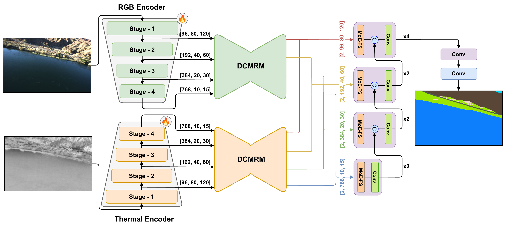
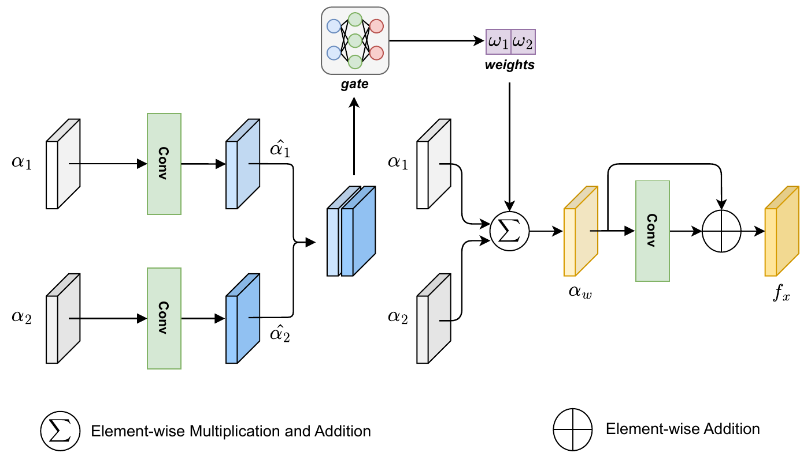
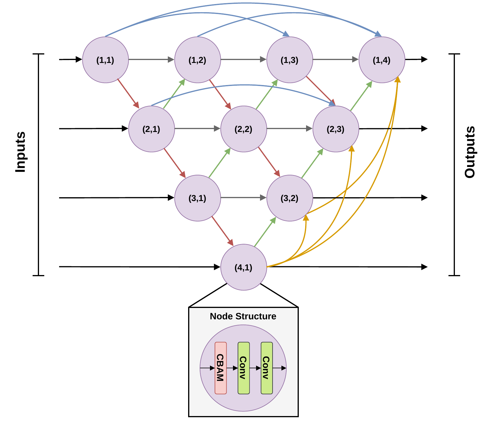
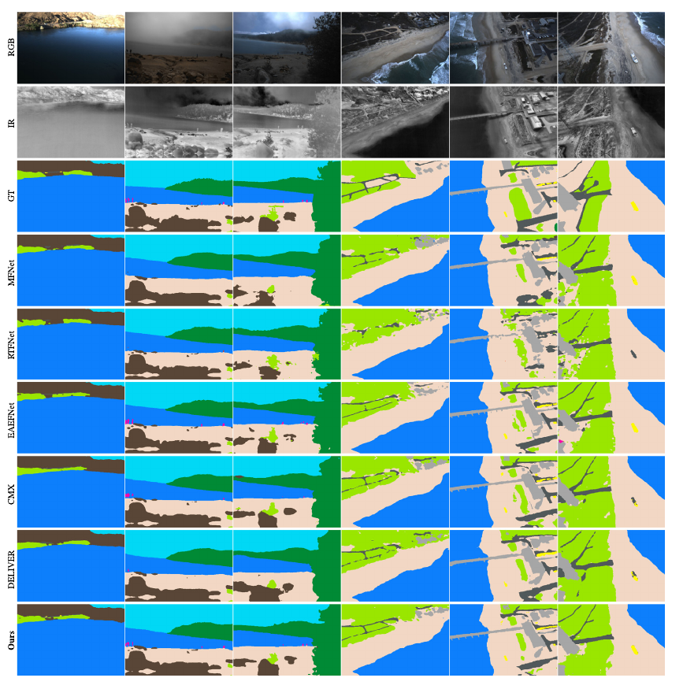
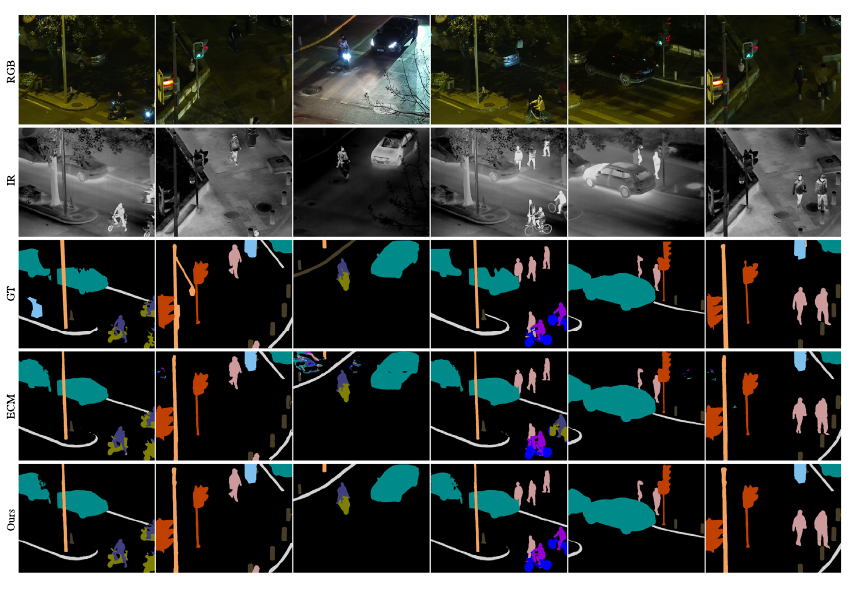

# MSR-MoE: Multi-scale rectified mixture-of-experts fusion for RGB–Thermal semantic segmentation

Official PyTorch implementation of our paper published in **Elsevier *Image and Vision Computing***.

> **Paper:** [Multi-scale rectified mixture-of-experts fusion for RGB–Thermal semanticsegmentation](https://doi.org/10.1016/j.imavis.2026.106109)

## Abstract

Semantic segmentation is essential for applications such as urban monitoring, UAV surveillance, autonomous driving and search-and-rescue missions. However, conventional RGB-based methods often fail under adverse conditions, including low illumination, shadows, fog, and bad weather, where visible-spectrum imagery becomes unreliable. Consequently, RGB–Thermal semantic segmentation has emerged as a promising approach for robust perception by leveraging the complementary characteristics of visible and thermal imagery. In this work, we propose a novel RGB–Thermal semantic segmentation framework that effectively exploits complementary information from both modalities. The framework consists of two key components: a Mixture-of-Experts Feature Selection Module (MoE-FS) for adaptive cross-modal feature integration and a Densely Connected Multi-scale Refinement Module (DCMRM) for improving structural consistency and boundary delineation across multiple scales. Together, these modules enable robust feature fusion and enhanced semantic discrimination in challenging environments. We conduct an extensive set of experiments on four benchmarks, i.e., Caltech RGB-T, FMB, SemanticRT, and PST900. The quantitative results demonstrate the effectiveness and robustness of the proposed method. It achieves state-of-the-art performance on Caltech RGB-T and SemanticRT, improving mIoU by up to 3.02% over existing methods, while exhibits competitive performance on PST900 and FMB datasets. Furthermore, qualitative results show robust segmentation of safety-critical dynamic classes, such as pedestrians, survivors and vehicles, especially under challenging visibility conditions. The framework also maintains competitive inference efficiency, making it suitable for multi-modal perception systems.

## Architecture

### Overall framework

The general architecture of the proposed multi-modal RGB–Thermal semantic segmentation framework. RGB and thermal inputs are processed independently through modality-specific encoders, extracting hierarchical features at four stages. These features are then refined by the DCMRM and adaptively fused using the MoE-FS blocks at multiple scales. The fused representations are progressively upsampled through lightweight convolutional layers to generate the final segmentation map.

<p align="center">
  
</p>

### Core modules

<table>
  <tr>
    <th align="center" width="50%">MoE-FS</th>
    <th align="center" width="50%">DCMRM</th>
  </tr>
  <tr>
    <td align="center" valign="middle"></td>
    <td align="center" valign="middle"></td>
  </tr>
  <tr>
    <td valign="top">
      <b>Mixture-of-Experts Feature Selection Module</b>
      <ul>
        <li><b>Purpose:</b> the reliability of each modality depends on the scene and scale: RGB offers rich texture and colour but degrades in low light, glare or bad weather, while thermal is illumination-robust but lacks fine detail. Fixed fusion (concatenation or summation) treats both equally and lets the weaker one add noise. MoE-FS instead adaptively selects the dominant modality at each spatial location and scale, exploiting their complementarity rather than diluting it.</li>
        <li><b>Code:</b> <code>MOE2</code> in <a href="models/oursnet/model.py">models/oursnet/model.py</a>.</li>
      </ul>
    </td>
    <td valign="top">
      <b>Densely Connected Multi-scale Refinement Module</b>
      <ul>
        <li><b>Purpose:</b> a UNet++-inspired module that improves structural consistency and boundary delineation by exchanging features across the four encoder scales before fusion. Each hierarchical node refines its input with CBAM (channel and spatial attention) followed by 3&times;3 convolutions with GELU, and nodes exchange features within a level and with adjacent levels via bilinear down/upsampling.</li>
        <li><b>Code:</b> <code>Mixer</code>, <code>NodeConv</code> and <code>CBAM</code> in <a href="models/oursnet/model.py">models/oursnet/model.py</a>.</li>
      </ul>
    </td>
  </tr>
</table>


## Results

Results are reported in mIoU. See the paper for full tables, per-class IoU and comparisons.

| Dataset | mIoU (%) | Config | Weights |
|---|---|---|---|
| SemanticRT | 79.69 | [semanticrt.yaml](configs/semanticrt.yaml) | [Download](https://drive.google.com/file/d/15rC0FJDmeqD2XAnAfr7k-2MksuFyNrPT/view?usp=sharing) |
| FMB | 63.19 | [fmb.yaml](configs/fmb.yaml) | [Download](https://drive.google.com/file/d/1nSP7zWUWQPwJNdW-vJ_2Wc08YWSjC1kn/view?usp=sharing) |
| Caltech RGB-T | 77.19 | [caltech.yaml](configs/caltech.yaml) | [Download](https://PLACEHOLDER/caltech) |
| PST900 | 85.93 | [pst900.yaml](configs/pst900.yaml) | [Download](https://drive.google.com/file/d/1GnpvPHOmERFp_vtbAZrpMd4-SZBlP1v_/view?usp=sharing) |


## Qualitative Results

Each column is one test sample. Rows show the RGB image, the thermal (IR) image, the ground truth (GT), the predictions of competing methods, and ours (last row).

### Caltech RGB-T

Compared with MFNet, KTFNet, EAEFNet, CMX and DELIVER, under low light, haze and aerial viewpoints.

<p align="center">
  
</p>

### SemanticRT

Compared with ECM on nighttime street scenes, where pedestrians, riders and vehicles are the safety-critical classes.

<p align="center">
  
</p>

## Installation

```bash
git clone https://github.com/dgkngzlr/MSR-MoE.git
cd MSR-MoE

conda create -n msrmoe python=3.10 -y
conda activate msrmoe

# 1) Install PyTorch for your CUDA version first: https://pytorch.org/get-started/locally/
#    e.g. pip install torch torchvision --index-url https://download.pytorch.org/whl/cu121

# 2) Install the remaining dependencies
pip install -r requirements.txt

# 3) (optional) log in to Weights & Biases, or set `general.logger` to something else in the config
wandb login
```

Notes:
- `albumentations>=2.0` is required (the transforms use the 2.x `fill` / `fill_mask` arguments).
- The encoders load the ImageNet-pretrained `convnextv2_tiny.fcmae_ft_in22k_in1k` weights through `timm` automatically on first run, and the `mean_iou` metric is fetched via `evaluate`, so the first run needs internet access.
- `wandb` is only needed when `general.logger: wandb`; `optuna` is only needed for `sweep.py` and `fvcore` only for `measure_flops.py`.
- The version bounds in `requirements.txt` are minimums inferred from the code, not a tested lockfile.

## Dataset Preparation

Place each dataset under `./data/<name>/` (the paths are set in `build_dataset` in [utils.py](utils.py)):

```
data/
├── caltech/      # rgb_{split}.txt, thermal8_{split}.txt, ...
├── semanticrt/   # rgb/, thermal/, labels/, {train,val,test}.txt
├── fmb/          # {split}/Visible, {split}/Infrared, {split}/Label
└── pst900/       # {split}/rgb, {split}/thermal, {split}/labels
```

Dataset sources: [Caltech RGB-T](https://github.com/aerorobotics/caltech-aerial-rgbt-dataset), [SemanticRT](https://github.com/jiwei0921/SemanticRT), [FMB](https://github.com/JinyuanLiu-CV/SegMiF), [PST900](https://github.com/ShreyasSkandanS/pst900_thermal_rgb). Please follow each dataset's own license and layout; check the corresponding file in [dataset_loaders/](dataset_loaders/) for the exact structure expected.

Optional helpers:

```bash
python visualize_dataset.py          # inspect samples
python compute_class_weights.py      # compute class weights for a dataset
```

## Usage

All experiments are driven by YAML files in [configs/](configs/).

### Training

```bash
# single GPU
python train.py --config configs/caltech.yaml

# multi-GPU
accelerate launch train.py --config configs/caltech.yaml
```

Logging uses Weights & Biases when `general.logger: wandb` is set in the config. Checkpoints are written to `checkpoints/`.

### Evaluation

Set `test.checkpoint` in the config to the downloaded weights, then run:

```bash
python test.py --config configs/caltech.yaml
```

### Hyperparameter sweep

```bash
python sweep.py --config configs/caltech.yaml --num_trials 20
```

### Model complexity

```bash
python measure_flops.py --height 480 --width 640 --num_classes 9
```

## Repository Structure

```
├── assets/             # architecture figures
├── configs/            # per-dataset YAML configs
├── dataset_loaders/    # dataset classes and transforms
├── losses/             # Dice + CE loss
├── models/oursnet/     # MoE-FS, DCMRM, encoder and decoder
├── train.py            # training
├── test.py             # evaluation / visualisation
├── sweep.py            # Optuna hyperparameter search
├── measure_flops.py    # FLOPs / params
└── utils.py            # builders for model, data, loss, scheduler
```

## Citation

If you find this work useful, please cite:

```bibtex
@article{gozler_msrmoe_2026,
  author={Gozler, Dogukan and Topal, Cihan},
  title={Multi-scale Rectified Mixture-of-Experts Fusion for RGB-Thermal Semantic Segmentation},
  journal={Image and Vision Computing},
  volume={174},
  pages={106109},
  year={2026},
  issn={0262-8856},
  doi={10.1016/j.imavis.2026.106109}
}
```

## License

This code is released under the [MIT License](LICENSE). The datasets are not included and remain under their authors' licenses.

## Contact

For questions, please open a [GitHub issue](https://github.com/dgkngzlr/MSR-MoE/issues) or email [gozler24@itu.edu.tr](mailto:gozler24@itu.edu.tr).
